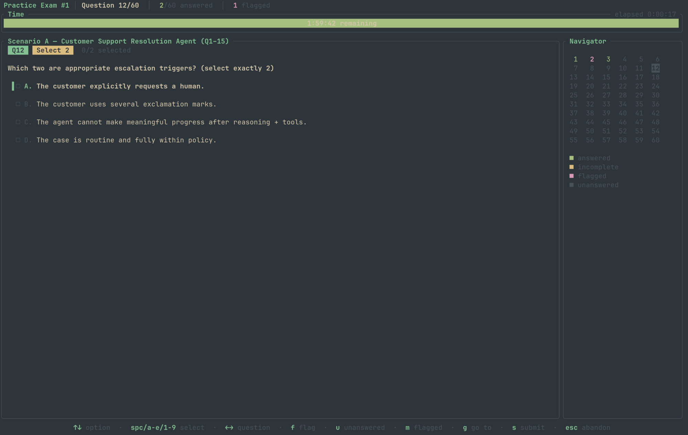
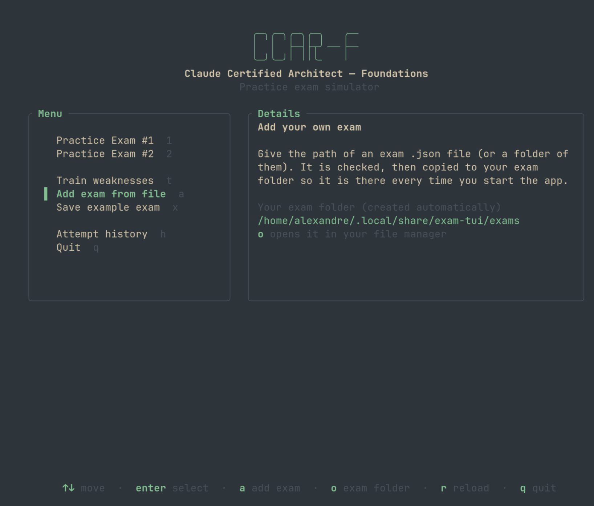
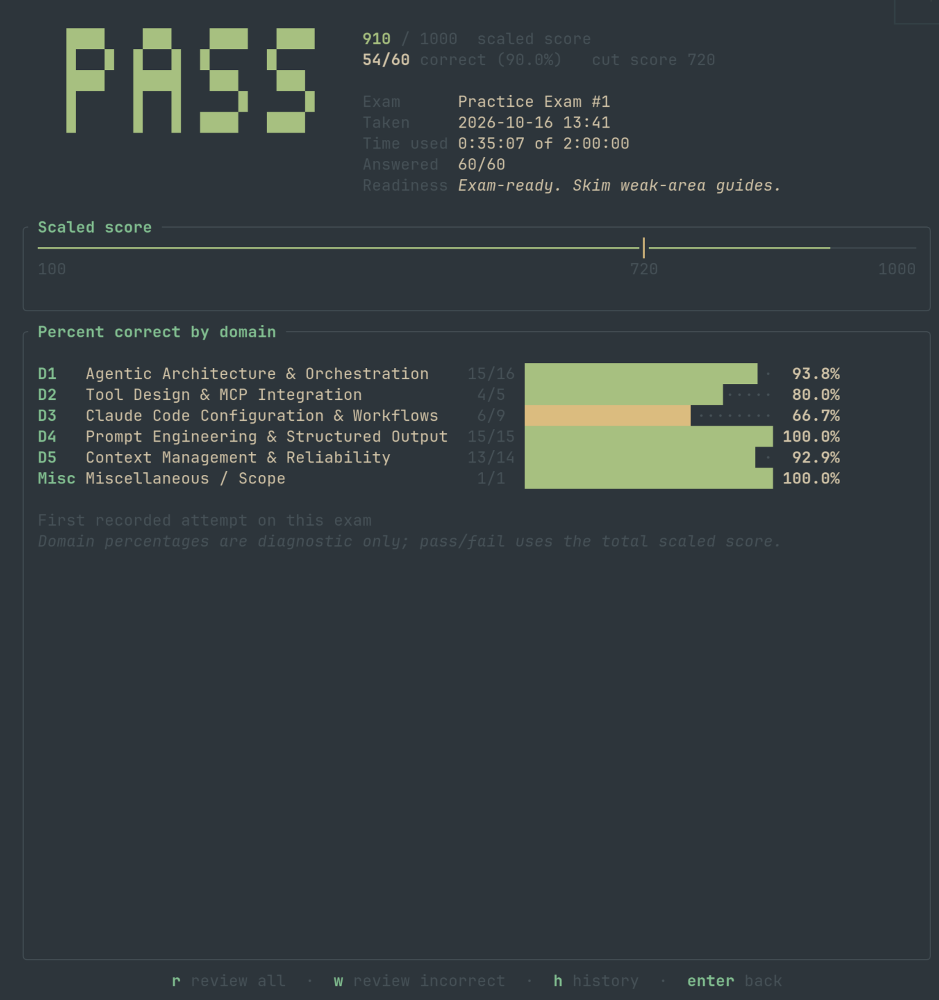
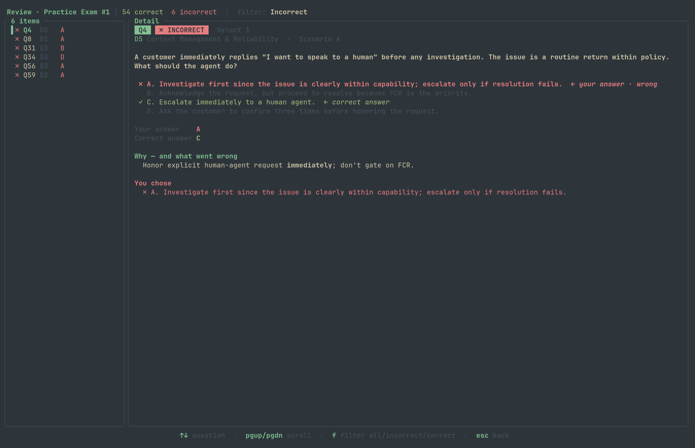
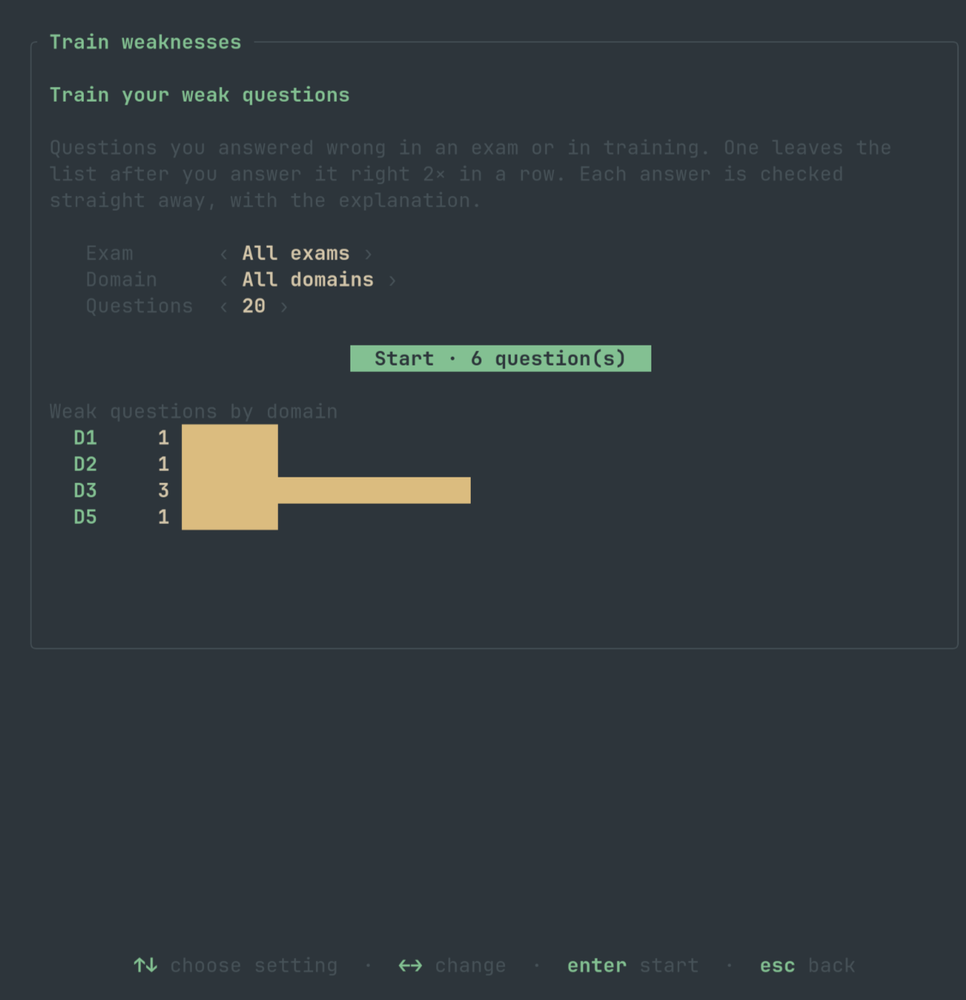
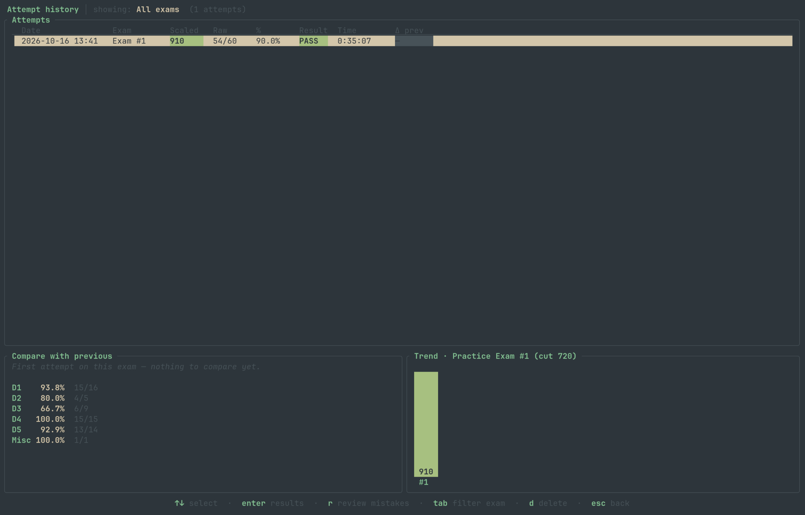

<div align="center">

# CCAR-F Practice Exam TUI

**Timed practice exams for the Claude Certified Architect – Foundations certification, right in your terminal.**

[](https://github.com/JaavLex/Claude_Certified_Architect_TrainingExams/releases/latest)
[](https://github.com/JaavLex/Claude_Certified_Architect_TrainingExams/releases)
[](https://github.com/JaavLex/Claude_Certified_Architect_TrainingExams/actions/workflows/ci.yml)
[](#-download-and-launch)
[](https://www.rust-lang.org)
[](LICENSE)

[**Download**](#-download-and-launch) · [Screenshots](#-screenshots) · [Features](#-features) · [Train weaknesses](#-train-your-weaknesses) · [Make your own exam](#-make-your-own-exams) · [Keys](#%EF%B8%8F-keys)



</div>

Practise for the **CCAR-F** exam under real exam conditions: **60 questions in 120 minutes**, scored on the official **100–1,000 scale with a pass mark of 720**. Afterwards, see exactly what you got wrong and why, compare with earlier attempts, and drill the questions you keep missing until you get them right.

No install needed: one small download per system (under 1.3 MB). The app uses your terminal's own colours, so it matches your theme.

## 🚀 Download and launch

**1. Download the file for your system** (v1.1.0):

| System | Download |
|---|---|
| 🪟 **Windows** 10/11 | [**exam-tui-v1.1.0-windows-x86_64.zip**](https://github.com/JaavLex/Claude_Certified_Architect_TrainingExams/releases/download/v1.1.0/exam-tui-v1.1.0-windows-x86_64.zip) |
| 🍎 **macOS** (Apple Silicon and Intel) | [**exam-tui-v1.1.0-macos-universal.zip**](https://github.com/JaavLex/Claude_Certified_Architect_TrainingExams/releases/download/v1.1.0/exam-tui-v1.1.0-macos-universal.zip) |
| 🐧 **Linux** x86_64 (any distro) | [**exam-tui-v1.1.0-linux-x86_64.tar.gz**](https://github.com/JaavLex/Claude_Certified_Architect_TrainingExams/releases/download/v1.1.0/exam-tui-v1.1.0-linux-x86_64.tar.gz) |
| 🐧 **Linux** ARM64 (e.g. Raspberry Pi) | [**exam-tui-v1.1.0-linux-aarch64.tar.gz**](https://github.com/JaavLex/Claude_Certified_Architect_TrainingExams/releases/download/v1.1.0/exam-tui-v1.1.0-linux-aarch64.tar.gz) |

All files, including checksums (`SHA256SUMS.txt`), are on the [releases page](https://github.com/JaavLex/Claude_Certified_Architect_TrainingExams/releases/latest).

**2. Unzip it and start the app:**

<table>
<tr><th>🪟 Windows</th><th>🍎 macOS</th><th>🐧 Linux</th></tr>
<tr valign="top">
<td>

Double-click **`exam-tui.exe`**.

The first time, Windows may show *"Windows protected your PC"*: click **More info → Run anyway**.

</td>
<td>

Double-click **`exam-tui`**. It opens in Terminal.

The first time, macOS may say it cannot verify the app: open **System Settings → Privacy & Security** and click **Open Anyway**.

</td>
<td>

In a terminal:

```sh
tar -xzf exam-tui-*-linux-x86_64.tar.gz
./exam-tui-*-linux-x86_64/exam-tui
```

</td>
</tr>
</table>

The warnings appear because the app is not code-signed; they only show on the first run.

<details>
<summary><b>Prefer the terminal?</b> One-line download and start for macOS and Linux</summary>

```sh
# macOS (files downloaded with curl skip the Gatekeeper prompt)
curl -LO https://github.com/JaavLex/Claude_Certified_Architect_TrainingExams/releases/download/v1.1.0/exam-tui-v1.1.0-macos-universal.zip
unzip exam-tui-v1.1.0-macos-universal.zip && ./exam-tui-v1.1.0-macos-universal/exam-tui

# Linux x86_64
curl -L https://github.com/JaavLex/Claude_Certified_Architect_TrainingExams/releases/download/v1.1.0/exam-tui-v1.1.0-linux-x86_64.tar.gz | tar -xz
./exam-tui-v1.1.0-linux-x86_64/exam-tui
```

On macOS you can also remove the warning for a downloaded copy with `xattr -d com.apple.quarantine exam-tui`.

</details>

**3. Pick an exam and press `Enter`.** The timer starts when you begin. Use `↑↓` and `Space` to choose answers and `←→` to move between questions, then press `s` to submit. All keys are listed [below](#%EF%B8%8F-keys).

> [!TIP]
> Use a terminal window of at least 80×24. From 96 columns, the question navigator appears next to the question.

## 📸 Screenshots

<table>
<tr>
<td width="50%"><br><sub><b>Menu</b>: pick an exam, train weaknesses, or add your own exam</sub></td>
<td width="50%"><br><sub><b>Results</b>: pass/fail, scaled score against the 720 cut, percent correct per domain</sub></td>
</tr>
<tr>
<td width="50%"><br><sub><b>Review</b>: your answer, the right one, and why</sub></td>
<td width="50%"><br><sub><b>Train weaknesses</b>: drill the questions you keep missing</sub></td>
</tr>
<tr>
<td colspan="2"><br><sub><b>History</b>: every attempt, compared with the previous one, with a score trend</sub></td>
</tr>
</table>

## ✨ Features

- 📝 **Two full practice exams**: 60 scenario-based questions each, across the five CCAR-F domains.
- ⏱️ **Real exam conditions**: a 120-minute timer that drains as you go (yellow at 25% left, red in the last 10 minutes) and submits automatically at zero.
- ☑️ **Exam-style answers**: each question says how many to pick ("Select 1", "Select 2") and you must pick exactly that many.
- 🧭 **Navigator**: see which questions are answered, incomplete, flagged or unanswered; flag questions and jump to any of them.
- 🎯 **Official-style scoring**: PASS/FAIL, scaled score 100–1,000, pass at 720, percent correct per domain, and readiness advice.
- 📊 **Graded like the real exam**: each domain counts at its share of the real exam, with the points each domain cost you and the domain to focus on next.
- 🏃 **Pacing coach**: an on-pace indicator, a timer for each question, and a "guess, flag, move on" prompt when one takes over 3 minutes.
- 🔍 **Full review**: every question with your answer, the correct answer and the explanation. Filter to only the ones you got wrong.
- 💪 **Train weaknesses**: practise the questions you miss most often, with instant feedback, until you get each right twice in a row.
- 📈 **Attempt history**: compare each attempt with the previous one, domain by domain, with a score trend chart.
- 🧩 **Your own exams**: save the template from the menu, edit it, and add it back. No coding or rebuilding.
- 🎨 **Fits your terminal**: uses your terminal's colour theme; works on Windows, macOS and Linux.

## 🎯 How it's scored

Scoring follows the CCAR-F Exam Guide, section 10, "How the Exam Is Scored":

| Rule | In the app |
|---|---|
| Items | 60 |
| Time limit | 120 minutes; submits automatically at zero |
| Item scoring | 1 point per item. "Select 2" items score only when both choices are correct (no partial credit) |
| Domain weighting | Each domain counts at its share of the real exam (Exam Guide §4): D1 27%, D2 18%, D3 20%, D4 20%, D5 15% |
| Unanswered | Counts as incorrect; wrong answers lose nothing extra, so always answer |
| Scaled score | 100–1,000 |
| Pass mark | **720** |
| Report | Pass/fail, scaled score, raw count, and percent correct per domain |

**Why weighting?** The Exam Guide says the domain weights are "the approximate proportion of scored items drawn from each domain". The practice exams don't follow that mix: Practice Exam #1 has only 5 D2 questions against about 11 on the real exam, and 15 D4 questions against about 12. A plain count would make a weak D2 almost invisible, so each domain's percent correct is weighted by its real-exam share:

```
weighted % = Σ (domain weight × domain % correct) / Σ weights      scaled = 100 + 900 × weighted %
```

For example, 54/60 correct with 15/16 · 4/5 · 6/9 · 15/15 · 13/14 across D1–D5 is 27×93.8% + 18×80% + 20×66.7% + 20×100% + 15×92.9% = **87.0% → 883**. Questions outside the five domains (the "Misc" scope question) don't count. Passing takes **68.9% weighted**. Results still show the raw count (54/60).

> [!NOTE]
> The official conversion from percent to the 100–1,000 scale is not published, so the app uses the straight-line mapping above. Attempts saved by earlier versions are re-graded from their saved answers when the app starts.

A question tagged with two domains (e.g. `D4/1`) counts under the first one. Custom exams are graded the same way when their domains have a `weight`. Without weights, every question counts the same (`scaled = 100 + 900 × correct / items`, so 42 of 60 to pass).

### What the results also show

These come from the Exam Guide and the study guide that comes with these practice exams:

| On screen | Where it comes from | What it tells you |
|---|---|---|
| **Weight** column and **Weighting** line | Exam Guide §4 domain weights | Each domain's share of your score, and your weighted percent. |
| **−pts** per domain and **Focus next** | Study plan: "a single weak domain can sink you" | How many scaled points each domain cost you (its share of the 900-point range × the part you missed), and which domain to study first. |
| **Attempt #1 · first attempt** | Study plan §6 and the pre-exam checklist: "≥85% on both practice exams on first full attempt, timed"; ≥90% means exam-ready | Whether this attempt counts toward readiness. Retakes score higher because you've seen the questions. |
| **Pace** per question, and questions over 3:00 | Study plan, test-day tactics: "2 min/question. If a question eats 3 min, guess + flag, move on" | Whether you'd finish in time, and which questions slowed you down. The review screen shows the time spent on each question. |

The **Attempt history** entry on the menu shows the readiness checklist: your first-attempt score on each exam against the 85% target, ★ when it reaches 90%, and how many weak questions are left to train.

During the exam, the header shows whether you're **on pace** (2:00 per question), and each question shows its own timer. If a question you haven't answered passes 3:00, a prompt suggests picking your best guess, flagging it and moving on.

## 💪 Train your weaknesses

Choose **Train weaknesses** on the menu (`t`) to practise the questions you get wrong.

- **Weak questions**: any question you've answered wrong, in an exam or in training. It stays weak until you answer it right **2 times in a row**. Questions left unanswered in an exam are ignored, since running out of time says nothing about what you know.
- **Weakest first**: the ones you missed last time, then the most-missed, then the highest miss rate. The set is shuffled so you don't learn the order by heart.
- **Focus**: choose the exam, the domain, and how many questions (10, 20, 30 or all). The setup screen shows your weak questions per domain.
- **Instant feedback**: no timer. `Enter` checks your answer and shows the correct one, the explanation, and whether the question is now mastered.

Training results are kept separately from exam attempts, so they never change your exam scores or history.

## 🧩 Make your own exams

Exams are plain JSON files, and you can add your own from inside the app:

1. **Get the template**: on the menu, choose **Save example exam** (`x`). It saves `exam-tui-example.json` to your Downloads folder by default (you can type another place). The download also includes it as `example-exam.json`.
2. **Edit it** in any text editor: change `id` and `title`, then write your own questions. See [Exam file format](#exam-file-format).
3. **Add it**: choose **Add exam from file** (`a`) and give the file's path. The app checks it and copies it into your exam folder, so it's in the menu every time you start. If something is wrong, it says what and where (e.g. `Q3: "select" is 2 but "answer" has 1 key(s)`) and keeps the box open so you can fix the file and press `Enter` again.

To update an exam, edit your file and add it again; an exam with the same `id` is updated, not duplicated. You can also add a whole folder of `.json` exams at once. The built-in ids `exam1` and `exam2` are reserved.

<details>
<summary><b>Entering a path</b>: drag and drop, paste, Tab completion</summary>

The path box works the same way on Windows, macOS and Linux:

- **Drag and drop** the file into the terminal window, or **paste** its path.
- **Tab** completes file and folder names; if several match, they are listed.
- `~` means your home folder (`~/Downloads/my-exam.json`). Environment variables work too: `$HOME/…`, `%USERPROFILE%\…`.
- Quoted paths from Windows "Copy as path" (`"C:\Users\me\My Exams\exam.json"`) are fine.
- Spaces escaped by the macOS or Linux terminal when dragging (`My\ Exams/exam.json`) and `file://` links from file managers are fine.
- Files saved by Notepad (UTF-8 with BOM) or PowerShell (UTF-16) are read correctly.

</details>

<details>
<summary><b>Where exams are stored</b></summary>

Added exams are copied to your exam folder, and every `*.json` file in it is loaded at start. The app creates the folder on its first run. Press `o` on the menu to open it in Explorer, Finder or your Linux file manager.

| System | Exam folder |
|---|---|
| Windows | `%APPDATA%\exam-tui\exams\` |
| macOS | `~/Library/Application Support/exam-tui/exams/` |
| Linux | `~/.local/share/exam-tui/exams/` |

Custom exams are marked with ✦ in the menu. To remove one, press `o`, delete its file, then press `r` to reload. You can also put files there yourself. Exams passed on the command line (`exam-tui path/to/exam.json`) are loaded for that run only, not copied. A file in the exam folder with the same `id` as a built-in exam replaces it.

</details>

### Exam file format

[`examples/custom-exam.json`](examples/custom-exam.json) is a complete 3-question example, and [`schema/exam.schema.json`](schema/exam.schema.json) is the full format. Keep the `"$schema"` line to get autocomplete and checking in editors such as VS Code.

```json
{
  "$schema": "https://raw.githubusercontent.com/JaavLex/Claude_Certified_Architect_TrainingExams/main/schema/exam.schema.json",
  "id": "my-exam",
  "title": "My Exam — optional subtitle",
  "description": "Shown in the menu.",
  "time_limit_minutes": 120,
  "domains": [
    { "id": "D1", "name": "Agentic Architecture & Orchestration", "weight": 27 }
  ],
  "questions": [
    {
      "number": 1,
      "scenario": "Scenario A — Customer Support Agent",
      "domain": "D1",
      "select": 1,
      "text": "Which `stop_reason` keeps the loop going?",
      "options": [
        { "key": "A", "text": "`end_turn`" },
        { "key": "B", "text": "`tool_use`" }
      ],
      "answer": ["B"],
      "why": "Explanation shown in the review screen."
    }
  ]
}
```

<details>
<summary><b>All fields</b></summary>

**Exam**

| Field | Required | Meaning |
|---|---|---|
| `id` | yes | Unique id. History and training are linked to it, so keep it when you edit the exam. |
| `title` | yes | Full title. The part before ` — ` is the short name in menus. |
| `description` | no | Text shown in the menu's Details panel. |
| `time_limit_minutes` | no | Time limit. Default: 120. |
| `domains` | no | `id`/`name` pairs for the per-domain breakdown, in display order. Add `weight` (a percent, e.g. `27`) to grade each domain at that share of the score; domains without a weight then don't count. |
| `questions` | yes | At least one question. |

**Question**

| Field | Required | Meaning |
|---|---|---|
| `number` | yes | Question number, unique in the exam. Keep it when editing, so training history still matches. |
| `text` | yes | The question. |
| `options` | yes | 2–9 options, each with a capital-letter `key` and `text`. |
| `answer` | yes | Keys of the correct options, e.g. `["A", "C"]`. |
| `select` | no | How many options to pick. Default: 1. Must equal the number of keys in `answer`. |
| `scenario` | no | Heading shown above the question. |
| `domain` | no | Domain id, e.g. `D1`. With `D4/1` the first id is used. |
| `why` | no | Explanation shown in review and training. |

In question, option, description and explanation text, `` `code` `` and `**bold**` are formatted.

**Checking a file.** The app checks every file when it loads; a file with mistakes is skipped and listed on the menu (press `e` for details). To check files without starting the app, run `exam-tui path/to/exam.json --check`. It checks, for example, that `answer` has exactly `select` keys, that every answer is one of the option keys, and that no question number or option key is repeated.

</details>

## ⌨️ Keys

Every screen shows its main keys at the bottom. The full list:

<details>
<summary><b>Show all keys</b></summary>

| Screen | Key | Action |
|---|---|---|
| Menu | `↑↓` / `j k`, `Enter` | Move, select |
| | `1`–`9` | Start that exam |
| | `t` | Train weaknesses |
| | `a` | Add exam from file |
| | `x` | Save example exam file |
| | `o` | Open your exam folder in the file manager |
| | `h` | Attempt history |
| | `r` | Reload exam files |
| | `e` | Show exam files that failed to load |
| | `q` | Quit |
| Exam | `↑↓` / `j k` | Move between options |
| | `Space` / `Enter` | Select or deselect the highlighted option |
| | `a`–`e` | Select the option with that letter |
| | `1`–`9` | Select the option in that position |
| | `←→` / `h l` / `Tab` | Previous / next question |
| | `f` | Flag or unflag the question |
| | `u` / `m` | Next unanswered / next flagged question |
| | `g` | Go to a question number |
| | `s` | Submit (asks for confirmation) |
| | `Esc` | Abandon the attempt (not saved) |
| Results | `r` / `w` | Review all / incorrect only |
| | `h` | History |
| Review | `↑↓` | Move between questions |
| | `PgUp` / `PgDn` (`K` / `J`) | Scroll the explanation |
| | `f` | Switch filter: all / incorrect / correct |
| Training setup | `↑↓` | Choose a setting |
| | `←→` | Change it |
| | `Enter` | Start |
| Training | `↑↓`, `a`–`e`, `1`–`9`, `Space` | Choose options, as in the exam |
| | `Enter` | Check the answer, then go to the next question |
| | `Esc` | End the session (answers already checked are saved) |
| History | `Enter` | Open the attempt's results |
| | `r` | Review that attempt's mistakes |
| | `Tab` | Filter by exam |
| | `d` | Delete the attempt |
| Path box | `Tab` | Complete a file or folder name |
| | `←→`, `Home` / `End` | Move the cursor |
| | `Ctrl+U` | Clear |
| | `Enter` / `Esc` | Confirm / cancel |

</details>

## 💾 Your data

Exam attempts (`attempts.json`), training results (`practice.json`) and your exams (`exams/`) are saved in your user data folder, so they survive updates and re-downloads:

| System | Folder |
|---|---|
| Windows | `%APPDATA%\exam-tui\` |
| macOS | `~/Library/Application Support/exam-tui/` |
| Linux | `~/.local/share/exam-tui/` |

To start over, delete `attempts.json` and `practice.json`.

## 🛠️ Build from source

You need a [Rust toolchain](https://rustup.rs), 1.85 or newer.

```sh
git clone https://github.com/JaavLex/Claude_Certified_Architect_TrainingExams.git
cd Claude_Certified_Architect_TrainingExams
cargo run --release          # or: cargo install --path .  then run  exam-tui
```

<details>
<summary><b>Command-line options</b></summary>

```sh
exam-tui                          # built-in exams + your exam folder
exam-tui my-exam.json other/      # also load these files or folders (this run only)
exam-tui my-exam.json --check     # validate exam files and exit
exam-tui --version
exam-tui --help
```

</details>

<details>
<summary><b>For maintainers</b>: releasing, CI and project layout</summary>

**Releasing a new version**

1. Change `version` in `Cargo.toml`, update `.github/RELEASE_NOTES.md`, and update the version in the download links at the top of this README.
2. Commit, then tag and push: `git tag v1.1.0 && git push origin main v1.1.0`.

The [Release workflow](.github/workflows/release.yml) then tests and builds every platform (static Linux x86_64/ARM64, universal macOS, Windows) and publishes the files with checksums to a GitHub release. It can also rebuild an existing tag from the Actions tab. The [CI workflow](.github/workflows/ci.yml) runs clippy and the tests on Linux, macOS and Windows for every push to `main`.

Run `cargo test` to check the built-in exams; they must keep the official format of 60 items and 120 minutes.

**Project layout**

```
src/
  main.rs   main loop and terminal setup
  app.rs    screens and key handling
  ui.rs     drawing each screen
  exam.rs   loading, checking, adding and saving exam JSON files
  score.rs  scoring and pass/fail
  train.rs  weak-question stats and selection for training
  paths.rs  reading typed, pasted and dragged paths on every OS
  store.rs  saved attempt history and training log
  text.rs   formatting and line wrapping
.github/    CI and release workflows, release notes
docs/       screenshots
exams/      built-in practice exams (JSON)
examples/   example custom exam
schema/     JSON Schema for exam files
```

</details>

## ⚖️ Disclaimer

This is an unofficial study tool, not affiliated with or endorsed by Anthropic. The practice questions are study material, not real exam questions.

## 📄 License

[MIT](LICENSE) © Alexandre Javet
